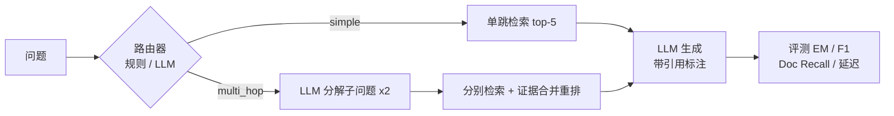

# Adaptive-RAG：面向多跳问答的自适应检索增强问答系统

> 完整的检索增强生成（RAG）对比研究项目：在 HotpotQA 上实现并系统对比 **Naive / Hybrid / Rerank / Adaptive** 四种 RAG 策略，包含统一评测框架、消融实验、错误分析与可交互演示界面。技术细节见 [REPORT.md](REPORT.md)。

## 项目亮点

- **四策略统一对比**：向量检索、BM25+向量 RRF 融合、CrossEncoder 两阶段精排、按问题复杂度自适应路由（单跳 / 分解多跳）
- **评测驱动**：EM / F1（HotpotQA 官方口径）+ Doc Recall@5（证据召回）+ 延迟/成本维度，每种改动都有量化收益
- **零依赖检索实现**：未使用 LangChain 等重框架，分块、索引、RRF 融合、评测全部手写，每一步可见
- **诚实报告负结果**：如 RRF 候选深度消融发现"加深召回反而降低精度"并给出机理解释（见 REPORT §4.2）

## 架构



## 快速开始

```powershell
# 1. 环境（Windows，Python 3.10+）
python -m venv .venv
.venv\Scripts\activate
pip install -r requirements.txt -i https://pypi.tuna.tsinghua.edu.cn/simple

# 2. 配置 LLM API（支持 DeepSeek / OpenAI / 本地 Ollama）
copy .env.example .env   # 编辑 .env 填入 API key

# 3. 数据与索引（自动下载 HotpotQA；国内建议先设 $env:HF_ENDPOINT='https://hf-mirror.com'）
python scripts/01_prepare_data.py
python scripts/02_build_index.py

# 4. 零成本实验（不需要 API key）
python scripts/03_run_eval.py --strategy naive --retrieval-only    # 向量检索评测
python scripts/03_run_eval.py --strategy rerank --retrieval-only   # 两阶段精排评测
python scripts/05_analyze_router.py                                # 路由器准确率分析

# 5. 端到端评测（需要 API key，成本约 1~3 元）
python scripts/03_run_eval.py --strategy naive --n 500
python scripts/03_run_eval.py --strategy adaptive --n 500 --router llm
python scripts/04_compare.py          # 汇总对比表 + 柱状图
python scripts/06_error_analysis.py   # 失败 case 归因分析

# 6. 交互演示
streamlit run app/demo_app.py
```

**数据集下载失败？** 手动下载 [hotpot_dev_distractor_v1.json](https://hotpotqa.github.io/) 放到 `data/raw/` 即可。

## 实验设计

| 策略 | 检索方式 | 改进维度 |
|---|---|---|
| Naive RAG | 向量检索 top-5 | 基线 |
| Hybrid RAG | BM25 + 向量 RRF 融合 | 检索质量 |
| Rerank | 向量粗排 20 → CrossEncoder 精排 5 | 检索精度 |
| Adaptive RAG | 路由器分流：简单题单跳 / 复杂题 LLM 分解多跳 | 系统级质量-成本权衡 |

**核心结果**（完整版见 REPORT.md）：

端到端（EM / F1，n=1000，语料 9,769 篇，deepseek-chat）：

| 策略 | EM | F1 | 证据召回 | 延迟 |
|---|---|---|---|---|
| Naive RAG | 50.1% | 63.5% | 86.4% | 0.95s |
| Hybrid RAG | 49.8% | 62.9% | 85.5% | 0.97s |
| Rerank | 50.5% | 63.8% | 86.5% | 1.43s |
| **Adaptive（规则路由）** | 51.8% | 65.8% | **90.5%** | 1.67s |
| **Adaptive（LLM 路由）** | **51.9%** | **66.2%** | 90.2% | 2.31s |

检索专项（Doc Recall@5，n=500）：Naive **86.8%** > Hybrid(depth5) 85.7% = Rerank 85.7% > Hybrid(depth10) 82.0%（消融见 REPORT §4.2）
路由器准确率（vs 题型金标准，n=1000）：LLM 77.3%（comparison 99.5% / bridge 72.0%）≈ 规则 76.8%（59.6% / 80.9%）——错误方向相反，详见 REPORT §4.3

## 项目结构

```
adaptive-rag/
├── app/demo_app.py          # Streamlit 演示界面（四策略切换）
├── scripts/
│   ├── 01_prepare_data.py   # 下载 HotpotQA → 语料库 + 评测集
│   ├── 02_build_index.py    # 向量 + BM25 双索引
│   ├── 03_run_eval.py       # 统一评测（支持 --retrieval-only / --router llm）
│   ├── 04_compare.py        # 汇总对比 + 图表
│   ├── 05_analyze_router.py # 路由器准确率分析
│   └── 06_error_analysis.py # 失败 case 归因（检索失败 vs 生成失败）
├── src/adaptive_rag/        # 核心代码
│   ├── indexing.py          #   向量索引 + BM25
│   ├── retrieval.py         #   统一检索接口（vector/bm25/hybrid-RRF）
│   ├── rerank.py            #   CrossEncoder 两阶段精排
│   ├── router.py            #   规则路由 + LLM 路由
│   ├── pipeline.py          #   四种 RAG 策略
│   ├── generation.py        #   OpenAI 兼容 LLM 客户端 + Prompt
│   └── evaluation.py        #   EM/F1/DocRecall 评测
├── results/                 # 全部实验结果 JSON + 图表
└── REPORT.md                # 技术报告（动机/方法/结果/消融/错误分析）
```

## 简历/文书表述参考

> Built an adaptive retrieval-augmented QA system on HotpotQA (9,769-passage open corpus): designed a complexity-based router that decomposes multi-hop queries, and systematically compared naive/hybrid/rerank/adaptive pipelines with EM, F1 and evidence-recall metrics (5,000+ LLM calls, ≈$1), including ablations showing RRF fusion depth non-monotonically affects recall and that adaptive gains compress as the corpus scales.

## 待办 / 延伸方向

- [x] 端到端实验（n=1000 × 5 配置，见 REPORT §4.4）
- [x] LLM 路由 vs 规则路由对比（结论：错误方向比准确率更重要，见 REPORT §4.3）
- [x] 数据规模扩展（500→1000 题 / 语料翻倍，优势收窄的诚实分析见 REPORT §4.4）
- [ ] RAGAS faithfulness / answer-relevance 评测
- [ ] 多跳迭代检索（IRCoT 式）——错误分析显示 33% 失败仍源于检索
- [ ] 推送 GitHub
