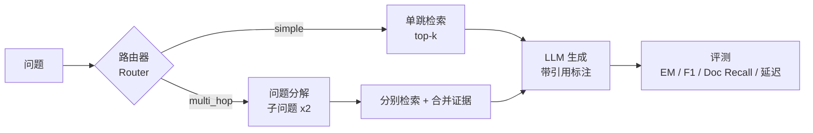

# Adaptive-RAG：面向多跳问答的自适应检索增强问答系统

> 两周冲刺版申研项目。针对多跳（multi-hop）问答场景，实现并对比 **Naive RAG / Hybrid RAG / Adaptive RAG（自适应路由）** 三种策略，用统一的评测框架量化每种设计的收益。

## 为什么这个项目有区分度

- 普通 RAG 项目 = "调 API + 跑通 demo"，没有区分度；本项目核心是**对比实验 + 量化结果**。
- 自适应路由（简单问题单跳检索、复杂问题自动分解多跳检索）源自 Adaptive-RAG (NAACL 2024) 的思路，实现门槛低但故事完整。
- HotpotQA 是标准学术数据集，EM/F1 指标有公认参照系，结果可直接写进简历。

## 架构



## 实验设计

| 策略 | 检索方式 | 说明 |
|---|---|---|
| Naive RAG | 向量检索 top-k | 基线 |
| Hybrid RAG | BM25 + 向量（RRF 融合） | 检索质量改进 |
| Adaptive RAG | 路由器分流：简单题单跳 / 复杂题分解多跳 | 系统级改进 |

**指标**：EM、F1（HotpotQA 官方指标）、Doc Recall@k（证据召回）、平均延迟。
**对照组维度**：回答质量 vs 延迟（成本），体现工程思维。

## 快速开始

```powershell
# 1. 创建虚拟环境并安装依赖（Windows，Python 3.10+）
python -m venv .venv
.venv\Scripts\activate
pip install -r requirements.txt
# 国内网络加速：pip install -r requirements.txt -i https://pypi.tuna.tsinghua.edu.cn/simple

# 2. 配置 LLM API（支持 DeepSeek / OpenAI / 本地 Ollama）
copy .env.example .env   # 然后编辑 .env 填入 API key

# 3. 准备数据（自动下载 HotpotQA 并构建语料库 + 评测集）
python scripts/01_prepare_data.py

# 4. 构建检索索引（无需 API key）
python scripts/02_build_index.py

# 5. 先零成本验证检索质量（不调用 LLM）
python scripts/03_run_eval.py --strategy naive --retrieval-only

# 6. 跑端到端评测（先用小规模试水）
python scripts/03_run_eval.py --strategy naive --n 50
python scripts/03_run_eval.py --strategy hybrid --n 50
python scripts/03_run_eval.py --strategy adaptive --n 50

# 7. 汇总对比 + 出图
python scripts/04_compare.py
```

**成本参考**：用 DeepSeek API 跑 500 题，全部实验加起来大约几元人民币；本地 Ollama 则免费。

## 两周计划 Checklist

### Week 1：打底 + 评测闭环
- [ ] Day 1–2：跑通"快速开始"全部流程，理解每个模块
- [ ] Day 3–5：阅读并修改 `src/adaptive_rag/retrieval.py`，尝试调整 top-k / 换 embedding 模型
- [ ] Day 6–7：拿到 Naive RAG 基线分数，记录到下方结果表

### Week 2：亮点 + 包装
- [ ] Day 8–10：升级 `router.py`——把规则路由改成 LLM 路由，并统计路由准确率（好素材！）
- [ ] Day 11–12：跑全量对比实验（n=300~500），完善 `scripts/04_compare.py` 图表
- [ ] Day 13–14：打磨 README 结果表、画架构图、写一页 PDF 技术报告

## 结果（待填）

| 策略 | EM | F1 | Doc Recall@5 | 平均延迟 (s) |
|---|---|---|---|---|
| Naive RAG | – | – | – | – |
| Hybrid RAG | – | – | – | – |
| Adaptive RAG | – | – | – | – |

## 延伸方向（时间富余再做）

- **Rerank**：加 CrossEncoder 重排（`sentence-transformers` 自带），对比检索质量
- **RAGAS 评测**：补充 faithfulness / answer relevance 等 LLM-as-judge 指标
- **引用可视化**：Streamlit 演示界面，答案中 [1][2] 可点击跳转原文
- **错误分析**：抽样 20 个失败 case 分类归因（检索失败 vs 生成失败），报告里非常出彩

## 简历/文书表述参考

> Built an adaptive retrieval-augmented QA system on HotpotQA; designed a complexity-based router that decomposes multi-hop queries, improving F1 by X% over the naive RAG baseline while keeping p50 latency within Y seconds.

## 项目结构

```
adaptive-rag/
├── scripts/            # 一条龙脚本：数据 → 索引 → 评测 → 对比
├── src/adaptive_rag/   # 核心代码（无重框架依赖，检索每一步可见）
├── data/               # 自动生成（gitignore）
└── results/            # 实验结果 JSON + 对比图表
```

## 常见问题

- **数据集下载失败**：手动从 [hotpotqa.github.io](https://hotpotqa.github.io/) 下载 `hotpot_dev_distractor_v1.json`，放到 `data/raw/` 目录即可，脚本会自动识别。
- **embedding 模型下载慢**：设置镜像 `set HF_ENDPOINT=https://hf-mirror.com` 后再运行。
